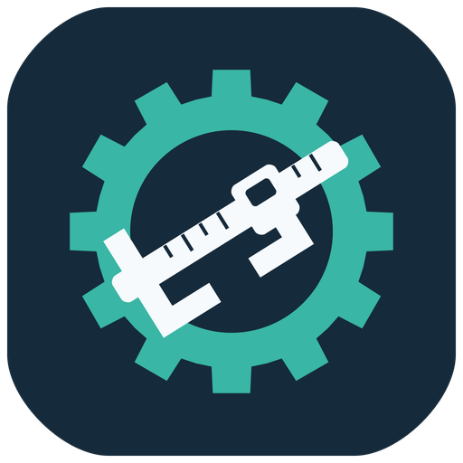

# 机设工具箱 v0.3.1

Windows 原生离线机械尺寸查询软件，采用 C# / .NET 10 / WPF。当前包含「螺纹孔与通孔」、「键与键槽」和「卡簧与卡簧槽」三个独立模块。



项目源码与原创图标采用 [MIT 许可证](LICENSE)。标准、制造商资料及运行时的权利说明见 [THIRD_PARTY_NOTICES.md](THIRD_PARTY_NOTICES.md)。

## 运行

推荐 `MechToolbox-0.3.1-win-x64-portable.zip`：完整解压后双击 `MechToolbox.exe`，适用于 Windows 10 / 11 x64，自带运行环境，无需安装 .NET。程序旁的 `data` 文件夹必须保留。

可从仓库的 Releases 页面下载。完整包适合直接使用，小体积版适合已经安装运行环境的电脑。程序未签名。

小体积版 `MechToolbox-0.3.1-win-x64-lite.zip` 需安装 [.NET 10 Desktop Runtime x64](https://dotnet.microsoft.com/en-us/download/dotnet/10.0)。仅安装普通 .NET Runtime 不含 WPF 组件。

## 螺栓页

只提供公制粗牙，收录 M1.6、M1.8、M2、M2.5、M3、M3.5、M4、M5、M6、M7、M8、M10、M12、M14、M16、M18、M20、M22、M24、M27、M30、M33、M36，共 23 个规格。

- 尺寸查询：只选粗牙标号，读取内螺纹建议标注、切削攻丝底孔，以及精／中等／粗装配通孔，可复制完整结果。新增内六角圆柱头的光滑头最大外径、滚花头最大外径、最大头高、内六角公称对边及最小深度。标号、内螺纹标注和复制内容均省略螺距，例如 M8、M8-6H。
- 孔径反查：只输入一个孔径，自动同时查询三档装配通孔与切削攻丝底孔，显示与输入孔径相差不超过 ±3 mm 的全部候选，包含两端边界。结果显示推荐孔径、用途和有正负号的差值，并优先排列最接近的孔径；无需选择孔类型或匹配偏差。
- 同一孔径可能对应多个标号或装配系列，全部候选均保留。双击候选行返回该规格的尺寸查询，并选中对应通孔系列。
- 已移除旧版「全规格对照表」界面及其 CSV 导出入口。

示例：输入 12 mm，列出 9～15 mm 的全部 12 项候选，其中 M10 粗装配通孔与 M14 攻丝底孔相同，优先显示；输入 6.8 mm，M8 攻丝底孔排在首位。差值 = 推荐孔径 − 输入孔径，0 表示相同。成品内螺纹的实测小径不能直接当作攻丝前底孔反查。

内六角圆柱头按 GB/T 70.1-2008 表 1 查询。例如 M8：光滑头最大外径 13、滚花头最大外径 13.27、最大头高 8、内六角公称对边 6、最小深度 4 mm。M14 为非优选规格。M1.8、M3.5、M7、M18、M22、M27、M33 未列于该标准，显示未收录提示，不外推头部尺寸。

## 键与键槽页

输入 6～500 mm 轴径（最多 3 位小数），按常用设计推荐选择普通平键截面；共 26 档。页面显示：

- 推荐平键截面 b×h、对应轴径档。
- 轴槽与轮毂槽宽、槽宽公差带、上下偏差与极限尺寸。
- 轴槽深 t₁、轮毂槽深 t₂ 和槽深偏差。
- 检验尺寸 d−t₁、d+t₂ 及其偏差；d−t₁ 的偏差与 t₁ 反向。
- 槽底圆角、名义顶隙、剖面示意、复制结果和键槽尺寸对照表。

正常联结为轴 N9 / 毂 JS9；紧密联结为轴与毂 P9；松联结为轴 H9 / 毂 D10。所有数值单位为 mm，槽宽偏差保留到 0.0001 mm，以完整表示 ±0.0125 等标准数值。

轴径分档属于常用设计推荐。**GB/T 1095-2003 表 1 不规定轴径选键区间**，实际选键需结合载荷及结构验算。边界规则：首档含 6 和 8，其余区间不含下限、包含上限；例如 30 mm 选 8×7，30.001 mm 进入 10×8 档。键长需根据轮毂长度和载荷另行确定，当前不做强度或键长计算。

## 卡簧与卡簧槽页

标准型 A 型：轴用 GB/T 894-2017，86 档公称轴径 3～300 mm；孔用 GB/T 893-2017，88 档公称孔径 8～300 mm。输入公称轴径或孔径，或从列表选择；不按实测直径自动套用相邻规格。

显示卡簧标号、厚度基本尺寸、自由状态内径／外径、槽径及其上下偏差与极限、槽宽 H13 的数值偏差与允许范围、名义槽深、最小端部边距及受载边槽底圆角。提供轴向剖面示意及完整结果复制；B 型重型、E 型、承载力及极限转速暂不查询。

轴用 40 mm：原表列槽径 37.0、槽深 1.25，两者不满足公称尺寸关系。本版保留来源原值供审查，但界面和复制内容屏蔽这两个加工值，显示待核对；需向挡圈制造商确认。孔用 40 mm 不受影响。

## 数据依据

螺栓模块保持 v0.1.0 的已核对数据：通孔按 [ISO 273:1979](https://www.iso.org/standard/4183.html)；切削攻丝底孔参考 [Gühring 公制攻丝表](https://guhring.com/media/support/Tapping-Tap-Drill-Sizes-Metric.pdf)，M1.6—M2.5 参考 [Series 815](https://guhring.com/media/tools/815.pdf) 的范围选取常用钻径。底孔为工艺推荐，不适用于挤压丝锥。6H 为一般用途建议内螺纹公差带。

键槽截面与公差按 [GB/T 1095-2003](https://openstd.samr.gov.cn/bzgk/std/newGbInfo?hcno=1F90F0327081018E769B4DC30FE7E7AA) 表 1 核对，轴径初选参考[嘉立创 FA 机械设计手册](https://www.jlcfa.com/mcbook/new05228.htm)。原表与二次资料不一致时采用原表，例如 100×50 截面的毂槽深采用 19.5 mm。完整来源、版本和适用说明位于 JSON 数据及「标准数据与依据」页面。

内六角圆柱头依据 [GB/T 70.1-2008](https://std.samr.gov.cn/gb/search/gbDetailed?id=71F772D7F825D3A7E05397BE0A0AB82A) 表 1，已逐项核对原表正文第 4、6 页及第 7 页脚注。数据表保留完整 20 个标准规格，当前螺栓选择范围内有 16 个对应规格。

程序查询完全离线；查看来源按钮会打开默认浏览器。

## 构建与检查

安装 .NET 10 SDK，在项目根目录执行：

```powershell
dotnet run --project tests/MechToolbox.Checks -c Release
dotnet build MechToolbox.sln -c Release
.\scripts\build-windows.ps1
```

核心检查还覆盖全部 174 档卡簧数据、轴用与孔用槽径偏差方向、原表矛盾屏蔽、非法输入清理及类型切换。核心检查覆盖原螺栓数据、全部键槽截面与槽宽公差、每个轴径档边界、尺寸链、反查同时包含通孔与底孔、反查 ±3 mm 边界及边界外排除、最近孔径排序与正负差值、粗牙标号省略螺距和无效输入清理。

Windows 界面检查：

```powershell
.\scripts\test-windows.ps1
```

也可直接运行已发布的程序：

```powershell
.\MechToolbox.exe --smoke-test C:\Users\Public\MechToolbox-smoke
```

检查会遍历 69 次螺栓规格／装配选择、78 次键槽规格／联结选择和 174 次卡簧规格选择，检查反查跳转、无效输入、模块切换的状态保留，并生成正常及最小窗口截图。截图仍需人工查看。v0.3.1 已通过 2049 项核心检查及目标 Windows 原生界面验收，见 [验证记录](docs/VALIDATION-v0.3.1.md)。如果系统禁止 PowerShell 脚本，可直接执行上面的 `dotnet` 命令构建与检查，并运行已发布程序的 `--smoke-test`；不要求修改系统执行策略。

## 扩展结构

`IStandardModule` / `ModuleRegistry` 注册查询模块，`IStandardDataProvider<T>` 读取独立数据，`DesktopModuleRegistry` 注册 WPF 界面。新增的 `IStandardDataModule` 为标准来源页面提供统一的来源列表和数据摘要。键槽模块已通过这些接口接入，未改动原螺栓尺寸数据。

数据文件分别为 `data/metric-coarse.v1.json`、`data/parallel-keyways-gb.v1.json` 、`data/socket-head-gbt70-1.v1.json` 和 `data/circlips-gb.v1.json`，启动时校验结构与版本。详细扩展约定见 [docs/EXTENDING.md](docs/EXTENDING.md)。

### v0.3.1 公差与图标

卡簧槽宽和通孔参考公差带 H12／H13／H14 均显示数值上、下偏差及允许尺寸范围，按 **实际槽宽或通孔直径** 分档，采用 ISO 286-2:2010 表 1。3 mm 和 6 mm 等分界值归入较小档，未外推收录范围。键槽深度及检验尺寸增加极限范围，原 N9／JS9／P9／H9／D10 数值偏差保留。

成品内螺纹 6H 增加中径、小径的数值偏差和极限尺寸，适用于正常旋合长度；M1.6—M16 按 ISO 965-2:2024 表 1 第 2 页，M18—M36 按 BETEC 目录印刷页 151 表 4 核对。6H 的零偏差基准为各自基本中径／小径，不能对推荐钻径直接加减；镀覆件需结合表面处理要求确定检验阶段。粗牙标号继续隐藏螺距。仅给出最大值／最小值的头部尺寸、工艺推荐钻径和明确标为基本尺寸的挡圈制造尺寸，没有自行添加通用公差。

图标为原创齿轮与游标卡尺，SVG、PNG、9 档尺寸 ICO 位于 `src/MechToolbox.Desktop/Assets`，重绘脚本为 `scripts/draw-icon.py`。应用 EXE、窗口和侧栏使用同一图案；完整包附带当前用户安装脚本 `Install-CurrentUser.ps1`，直接更新并逐文件校验，更新桌面快捷方式图标，不创建旧版备份。
